 

## 👤 &nbsp;ABOUT ME

<table>
<tr>
<td width="62%" valign="top">

I'm a **second-year ICT student** at **Arrupe Jesuit University** in Harare, specialising in **Software Development and Networking**.

I like making things work: routers talking to each other, databases that keep records straight, and circuits that actually power on. Outside tech you'll find me into **anime, games, cars, music and volleyball**.

> *"Teamwork on the court, teamwork in the network."* 🏐

</td>
<td width="38%" valign="top">

**⚡ QUICK STATS**

🎓 BSc (Hons) ICT, Year 2 
📍 Harare, Zimbabwe 
🏥 Clinic volunteer: records & databases 
🏐 Volleyball 
🎯 Goal: IT/ICT attachment

</td>
</tr>
</table>

 

## 🎒 &nbsp;LOADOUT

<table align="center">
<tr>
<td align="center" width="33%"><h3>🎌</h3><b>ANIME</b> Big stories, big fights, big soundtracks</td>
<td align="center" width="33%"><h3>🎮</h3><b>GAMES</b> Always one more match</td>
<td align="center" width="33%"><h3>🏎️</h3><b>CARS</b> Engines, design and speed</td>
</tr>
<tr>
<td align="center"><h3>🎧</h3><b>MUSIC</b> The soundtrack to every debug session</td>
<td align="center"><h3>🏐</h3><b>VOLLEYBALL</b> Timing, teamwork, communication</td>
<td align="center"><h3>💻</h3><b>ICT</b> Networks, databases, code</td>
</tr>
</table>

 

## ⚔️ &nbsp;SKILLS

 

 

## 📜 &nbsp;QUEST LOG &nbsp;(click a quest to expand)

<b>🐍 Python GPA Management System</b> &nbsp;<code>Python</code> <code>SQLite</code>

 

Manages student, course and grade records. Calculates GPA, validates input and generates text reports.

<b>🌐 Multi-Branch Enterprise Network</b> &nbsp;<code>Cisco Packet Tracer</code>

 

Simulated multi-site network with routers, switches and end devices. Uses DHCP, NAT, ACLs and OSPF, plus a study of VPN connectivity and WAN redundancy.

<b>🔐 FinTrust Microfinance WAN</b> &nbsp;<code>GRE</code> <code>OSPF</code> <code>IPsec</code>

 

Head office and branch routers linked over an ISP underlay with GRE tunnels and OSPF routing, then protected with an IPsec encryption layer.

<b>🌾 Farm Connect Global</b> &nbsp;<code>Systems Analysis</code>

 

Systems analysis and design for an agricultural marketplace connecting farmers, buyers and logistics providers: requirements, features, database model and interface planning.

<b>🗄️ ICT Equipment Management Database</b> &nbsp;<code>MS Access</code>

 

Database design for ICT equipment, users, allocations and maintenance records, using primary keys, foreign keys and table relationships.

 

## 🎧 &nbsp;NOW PLAYING

<table>
<tr><td>

▶️ &nbsp;**Building WAN labs** &nbsp;`GRE` `OSPF` `IPsec` 
▰▰▰▰▰▰▱▱▱▱ &nbsp;in progress

</td></tr>
<tr><td>

⚡ &nbsp;**Designing circuits in EasyEDA** &nbsp;`machine monitor` 
▰▰▰▱▱▱▱▱▱▱ &nbsp;early stages

</td></tr>
<tr><td>

📈 &nbsp;**Levelling up Python and Java** &nbsp;`coursework` 
▰▰▰▰▰▱▱▱▱▱ &nbsp;always climbing

</td></tr>
</table>

 

## 📊 &nbsp;STATS

 

## 📡 &nbsp;CONTACT

